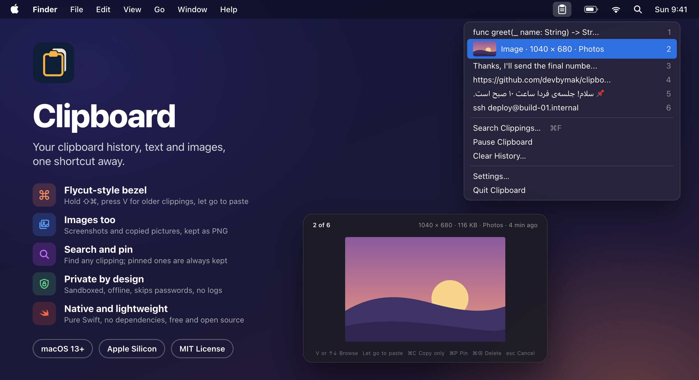

<div align="center">

# Clipboard: clipboard history for the Mac menu bar, with images

**Everything you copy, text and images, one shortcut away. Free, open source, and private.**


</div>

<p align="center">
  
</p>

**Clipboard** is a small, native macOS menu bar app that remembers what you copy. It works like [Flycut](https://apps.apple.com/us/app/flycut-clipboard-manager/id442160987): press <kbd>⇧</kbd><kbd>⌘</kbd><kbd>V</kbd>, keep holding <kbd>⇧</kbd><kbd>⌘</kbd> and tap <kbd>V</kbd> to go back through your clippings, then press <kbd>Return</kbd> to paste. Unlike Flycut, it also keeps **images**: screenshots, pictures copied from a browser, Preview, Photos, or a design app.

## Why Clipboard

- ⌨️ **Flycut-style bezel.** One shortcut shows your newest clipping. Tap <kbd>V</kbd> again for older ones, or use the arrow keys, number keys or scroll wheel, then press <kbd>Return</kbd> to paste.
- 🖼️ **Images too.** Screenshots and copied pictures are kept as PNG, with thumbnails in the menu and a full preview in the bezel. They paste back into any app.
- 📋 **Menu bar history.** Click the clipboard icon for your recent clippings. Press <kbd>1</kbd> to <kbd>0</kbd> to paste one, or hold <kbd>⌥</kbd> to delete one.
- 📸 **Screenshots to the clipboard.** Optionally, each screenshot you take with <kbd>⇧</kbd><kbd>⌘</kbd><kbd>3</kbd> or <kbd>⇧</kbd><kbd>⌘</kbd><kbd>4</kbd> is copied too, ready to paste, and still saved as a file.
- 🔎 **Search and pin.** Type to search in the bezel. Pin a clipping with <kbd>⌘</kbd><kbd>P</kbd> to keep it however much you copy.
- ✨ **Pastes for you.** After you choose a clipping, Clipboard pastes it into the app you're in. Or turn that off and just press <kbd>⌘</kbd><kbd>V</kbd> yourself.
- 🔒 **Private by design.** Skips passwords and anything else apps mark as confidential. Runs in the App Sandbox with no network access, keeps your history only on your Mac, and writes no logs. Pause it from the menu at any time.
- 🪶 **Lightweight.** Pure Swift with no third-party dependencies. Launches at login if you want it to.

## Install

You need an Apple silicon Mac and macOS 13 Ventura or later. Install with [Homebrew](https://brew.sh):

```sh
brew tap devbymak/tap
brew trust devbymak/tap
brew install --cask clipboard
```

Homebrew asks you to trust taps from outside Homebrew before it installs from them. Clipboard isn't notarized by Apple (that needs a paid developer account), so the cask clears macOS's download warning for you. `brew upgrade` keeps it up to date. Look for the clipboard icon in your menu bar.

To build from source instead, you also need the Xcode Command Line Tools (`xcode-select --install`):

```sh
git clone https://github.com/devbymak/clipboard.git
cd clipboard
./build.sh --install
```

This builds Clipboard, copies it to `/Applications`, and opens it.

The first time it opens, macOS asks whether Clipboard may control your computer. That's the **Accessibility** permission, which Clipboard needs to press <kbd>⌘</kbd><kbd>V</kbd> for you. Without it, choosing a clipping copies it, and you paste it yourself. If macOS asks before Clipboard reads what you copy, allow it, or Clipboard can't keep your clippings. Each new version has a new signature, so after an upgrade, remove Clipboard from System Settings → Privacy & Security → Accessibility and add it again.

macOS saves screenshots as files, not to the clipboard. To have Clipboard copy each new one, turn on **Copy screenshots to the clipboard** in Settings → General, and choose the folder your screenshots go to (the Desktop unless you changed it in the Screenshot app's Options). Clipboard can read only that folder, and only after you choose it.

## Using the bezel

| Key | What it does |
| --- | --- |
| <kbd>⇧</kbd><kbd>⌘</kbd><kbd>V</kbd> | Show the bezel with your newest clipping. Press <kbd>V</kbd> again for older ones. |
| <kbd>Return</kbd> | Paste the clipping shown. |
| Type | Search your clippings. |
| <kbd>↑</kbd> <kbd>↓</kbd> or scroll | Browse newer and older clippings. |
| <kbd>⌘</kbd><kbd>1</kbd> to <kbd>⌘</kbd><kbd>0</kbd> | Jump to the first to tenth clipping. |
| <kbd>⌘</kbd><kbd>C</kbd> | Copy the clipping shown without pasting it. |
| <kbd>⌘</kbd><kbd>P</kbd> | Pin or unpin it. |
| <kbd>⌘</kbd><kbd>⌫</kbd> | Delete it. |
| <kbd>esc</kbd> | Close without pasting. |

The bezel stays open until you choose a clipping. Prefer Flycut's way, where letting go of <kbd>⇧</kbd><kbd>⌘</kbd> pastes? Turn off **Keep open until you choose** in Settings. **Search Clippings…** in the menu keeps it open either way. You can change the shortcut in Settings → General.

## Privacy

Clipboard never connects to the network: its sandbox doesn't allow it. Nor can it read your files, except the screenshots folder, if you choose one. It doesn't keep copies that password managers and other apps mark as confidential or temporary ([nspasteboard.org](http://nspasteboard.org) markers), and it doesn't keep anything while paused. Your history is saved only on your Mac, in `~/Library/Containers/local.clipboard`: up to the number of clippings you choose (40 by default), plus any you pin, and within the size limit you choose (500 MB by default). Over it, the oldest clippings you haven't pinned are removed. Turn off **Save history** to keep clippings in memory only. Turning it off also deletes the saved copy.

<details>
<summary><b>For developers</b></summary>

```sh
./test.sh    # run the tests
./build.sh   # build Clipboard.app here without installing it
```

- `Clipboard.app/Contents/MacOS/clipboard --list` prints your saved clippings.
- `--probe` describes what's on the clipboard now and what Clipboard would keep, without printing the content itself.
- Preferences are stored in `~/Library/Containers/local.clipboard`.

macOS ties the Accessibility permission to the app's signature, and the default ad hoc signature changes with every build. After you rebuild, remove Clipboard from System Settings → Privacy & Security → Accessibility and add it again.

The default build is signed ad hoc, so macOS blocks a downloaded copy until its quarantine flag is removed, which the Homebrew cask does. To share it without that, sign it with a Developer ID and notarize it:

```sh
CLIPBOARD_SIGN_IDENTITY='Developer ID Application: Your Name (TEAMID)' ./build.sh
ditto -c -k --keepParent Clipboard.app Clipboard.zip
xcrun notarytool submit Clipboard.zip --keychain-profile <profile> --wait
xcrun stapler staple Clipboard.app
```

`assets/app-icon.png` is the app icon; `assets/icon-prompt.txt` records its image-generation prompt. `assets/cover.html` is the cover, with demo data; the command to render it to `assets/cover.png` is at the top of the file.

</details>

## License

MIT. See [license](license). Contributions and stars are welcome ⭐
